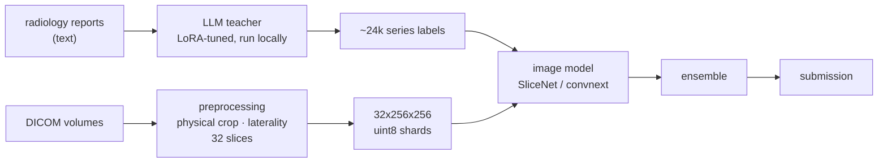

<div align="center">

> **Competition data is not in this repository.** Radiology report text, the 58 expert
> labels and every per-study label or prediction table were removed before publication,
> as the RSNA competition rules require. Scripts that read them expect the competition
> files under `data/` and the generated tables under `artifacts/`.

# RSNA 2026 Knee MRI — Abnormality Detection

**Detecting 12 knee pathologies from MRI, trained on 58 expert labels.**

[](https://www.kaggle.com/competitions/rsna-knee-abnormality-detection/leaderboard)
[](https://www.kaggle.com/competitions/rsna-knee-abnormality-detection/leaderboard)
[](#trajectory)
[](#)
[](#)

<sub>Deadline 2026-10-22 · 84 models trained · 196 queued jobs · a 6,600-line lab notebook</sub>

</div>

---

## The problem

The competition ships **58 studies with radiologist labels**. Everything else is
unlabelled imaging plus free-text radiology reports. A 3D CNN trained on 58
studies learns nothing.

So almost none of the work here is model architecture. It is (1) manufacturing a
trustworthy training signal from unlabelled data, and (2) — much harder — building
instruments precise enough to tell whether a change to it helped.



The teacher reads reports, so it cannot exist at test time. Its only job is to
label the training set. **The image model is what gets submitted.**

### The student beats its teacher, and the split is physical

Against the 58 real radiologist labels, the image model scores **0.909 to the
teacher's 0.899** — a student trained entirely on its teacher's output exceeding
it on six of twelve findings. It cannot have inherited what the teacher does not
have, so the gain is the image carrying information the report omits.

Which six is the interesting part:

| image model wins | | teacher wins | |
|:--|--:|:--|--:|
| Effusion | **+0.095** | Medial Meniscus | −0.040 |
| Baker's cyst | **+0.076** | ACL | −0.035 |
| Medial OA | **+0.060** | MCL | −0.031 |
| Contusion | **+0.051** | PF OA | −0.027 |

**Every finding the model wins is something you *see*.** Joint fluid, a cyst,
cartilage loss, a bone bruise. **Every finding the teacher wins is something a
report *states*** — the ligament and meniscus tears that are the headline of a
knee MRI report. Effusion is unmistakable on the image and routinely unmentioned
in text; an ACL tear is the sentence the report exists to write.

This also explains a failed experiment. Label blending was applied at one weight
across all twelve findings and landed nowhere — a uniform blend spends the gain
on Effusion to pay for the loss on ACL.

---

## The actual difficulty: every instrument is noisier than the effect

The effects worth chasing here are 0.001–0.005 AUC. Every available measuring
device has a replicate spread of the same order. Nothing can be concluded until
you know which.

| instrument | what it is | replicate **sd** | cost | how far to trust it |
|:--|:--|:--:|:--:|:--|
| **pv-hold** | 522 studies, teacher-labelled, never used to pick an epoch | **0.0024** | free | Primary for *recipe* changes. Blind to representation changes. |
| **pv-sel** | the other 522-study half, used to pick the epoch | 0.0042 | free | Directional only — inflated by its own selection. |
| **gold** | 58 studies, real radiologist labels | 0.0055 | free | Real labels, tiny sample. Needs 2–3 sd to say anything. |
| **public LB** | ~955 hidden studies | 0.001 quantised | ~6 h, 5/day | The only instrument that has ever settled a disagreement. |

Those standard deviations are **measured across four seeds of one identical
recipe**, not assumed. Getting them cost four training runs that produced no new
model — and they are the single most valuable thing in this repository.

> **The trap this repo fell into, and documented.** For weeks pv-hold was believed
> to have sd 0.0005. Three tightly-clustered seeds had been mistaken for a spread.
> A fourth seed put it at 0.0024 — five times wider — which retroactively voided
> every conclusion that had rested on a gap smaller than that. The fix was not a
> better model. It was one more replicate.

---

## What this project is really a record of

<table>
<tr><td width="50%" valign="top">

**Ruled out, with readable margins**

- backbone-family diversity (DINOv2, Swin)
- study-level attention over series
- per-finding best-plane selection
- flip-TTA · capacity · pos_weight
- 2.5D neighbour channels
- metadata conditioning (plane, contrast)
- teacher relabelling by a frontier LLM

</td><td width="50%" valign="top">

**Confirmed, and priced**

- ensembling pays, then saturates at ~2 members/recipe
- frozen backbones rescue whole model families (+0.019 on Swin)
- physical-scale crop + laterality normalisation
- probability mean over rank mean, measured not assumed
- the model beats its own teacher on the macro

</td></tr>
</table>

**Nineteen axes have been opened, measured and closed.** That is the deliverable.
A negative result that is *measured* costs the same as a positive one and is worth
more than an unmeasured hunch, because it is the only thing that stops the next
four weeks being spent the same way.

---

## Three claims made, and retracted, in 36 hours

The 2.5D attempt is the one worth reading. SliceNet fed each slice to the backbone
as `s.expand(-1, 3, -1, -1)` — the same grayscale image in all three input channels
— so two of three had carried a duplicate since the project's first run. Filling
them with neighbouring slices is *free*: same tensor shape, same FLOPs, same
pretrained stem. It raised pv-hold by 0.0064 and was written up here as breaking
the ceiling.

It then lost on the leaderboard. Twice. At two resolutions.

The reason was already in this repo, written three weeks earlier and walked past:
**pv-hold measures agreement with a teacher that is itself only 0.900 accurate.**
2.5D improved agreement with the teacher without improving the prediction.

Each retraction was caught by a rule the previous retraction had just added. Those
rules — compare plateaus not delivered checkpoints; know each instrument's
replicate spread; never let one instrument rule alone on a representation change;
require gold to move 2–3 of its own sd rather than merely point the right way —
are the substance of this project now.

---

<h2 id="trajectory">Trajectory</h2>

This project reached **3rd place out of 2,408 teams** and held a top-10 position
for two weeks.

| date | score | rank | field |
|:--|:--:|:--:|--:|
| 17 Aug | 0.929 | **3rd** | 626 |
| 21 Aug | 0.946 | **3rd** | 2,075 |
| **24 Aug** | **0.947** | **3rd** | **2,408** |
| 27 Aug | 0.947 | 5th | — |
| 01 Sep | 0.947 | 10th | — |
| 04 Sep | 0.947 | 18th | 3,018 |
| 24 Sep | 0.948 | 74th | 4,279 |

**The score never went down.** Every place lost was lost standing still, while
the field converged and nearly doubled. A public leaderboard on a saturating
problem is a moving target, and the honest reading of the August peak is that
ranks 2 through 11 spanned 0.947–0.943 at the time — inside the public split's
own sampling noise. That was written into the lab notebook on the day it
happened, in exactly those words, rather than after the rank fell:

> *"Our rank is largely noise and must not be used to steer anything."*
> — `experiments.md`, 21 August, while ranked 3rd

## Where it stands

```
        our score  0.948          ████████████████████░  74th of 4,279
     10th place    0.955          ████████████████████████
          1st      0.958          █████████████████████████
```

The gap to the prize line is **+0.007**. The best local instrument resolves
**0.011** at 2 sd. The improvement needed is *half the resolution of the ruler* —
which means "only submit what wins locally" can never produce a candidate, and the
leaderboard has to be used as the instrument rather than the scoreboard.

That is the current phase: the most recent work blends our ensemble with a
publicly released, genuinely decorrelated model (rank correlation 0.868 against
ours), submitted at four weights at once because no local instrument can order
them.

Checking that number against every model on disk immediately corrected it: a
medically-pretrained backbone trained here in August and shelved for scoring
poorly on its own sits at **0.839** — more decorrelated than the public package,
and the only in-house member that is both different *and* not harmful in a blend.
It had been filed under "ruled out" on a criterion — solo quality — that the
rest of this page argues is the wrong one for an ensemble member.

---

## Layout

```
src/
  volume.py              DICOM → volume: physical-scale crop, laterality normalisation
  train_image.py         the image model; resumes from last.pt, one-epoch granularity
  ensemble.py            probability / rank mean over any set of checkpoints
  ensemble_search.py     exhaustive roster search; board-refused members dropped by default
  gpu_queue.sh           single-slot runner: VRAM gating, dependency checks, exit-status reporting
  push_*.py              Kaggle kernel + dataset plumbing
  kernels/               code that runs inside Kaggle kernels
artifacts/
  experiments.md         6,600 lines: every run, every retraction, with reasons
  queue.txt              pending jobs, top line next; comments carry the rationale
HANDOFF.md               state of play — read this first
```

`artifacts/experiments.md` is the repository. The code is small and unremarkable;
the record of what was measured, what was believed on the strength of what, and
what had to be withdrawn is the part worth reading.

---

## Running it

Requires [uv](https://docs.astral.sh/uv/), an NVIDIA GPU (developed on a 5090), and
Kaggle credentials at `~/.kaggle/`.

```bash
uv sync

# train one image model
uv run python -u src/train_image.py --arch slicenet \
  --backbone convnext_tiny.in12k_ft_in1k --batch 4 --lr 3e-4 --epochs 16 \
  --size 256 --stream --pool 8 --upsample 336 --aug --cosine --tag mytag

# score an ensemble of finished checkpoints on both instruments
uv run python -u src/ensemble.py m31newshards m33up336new m38seed1 --halves

# submit: upload checkpoint → push kernel → submit
uv run python src/push_member_dataset.py mytag
uv run python src/push_submit_model.py --tag ens --dataset qwrfsdr/rsna-knee-image-model-mytag
```

Long jobs go through the queue rather than being launched by hand:

```bash
echo "uv run python -u src/train_image.py ... --tag next" >> artifacts/queue.txt
```

The runner picks it up within a minute of the GPU freeing, refuses to launch
without enough free VRAM, **checks that a job's input files exist before starting
it**, and records the exit status of every job. Each of those three guards was
added after it cost a real experiment.

---

## Data

Competition DICOMs are not redistributed (`data/` is ignored), and neither are
model weights or the preprocessed volume shards — all are rebuilt from Kaggle by
the preprocessing kernel. Teacher-derived label tables under `artifacts/` **are**
tracked: they cost real inference to produce and are the expensive part of this
repository.
